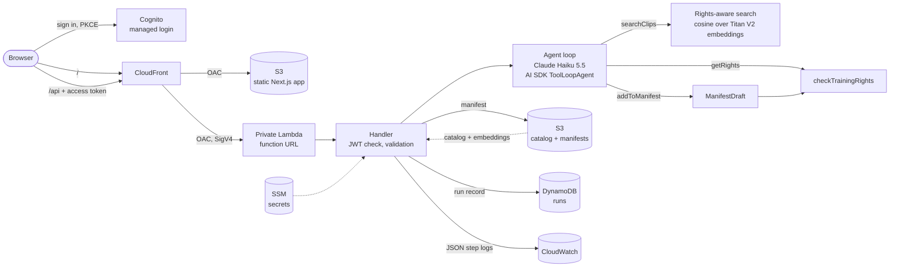

# Clearframe

[](https://github.com/fabio-carucci/clearframe-agent/actions/workflows/ci.yml)

An agent that assembles **rights-cleared video datasets for AI training**. You describe the
dataset you need; the agent searches a clip catalog, checks every license, and returns a validated
manifest: the clips it chose, why, what it refused, and what the request cost.

A signed-in user sends `{"prompt": "5 clip di natura in inglese", "territory": "ES"}` from the web
app. The manifest that comes back, trimmed to one of the five clips:

```json
{
  "runId": "b5d3b05b-527e-4b65-9107-61b33eb15cfc",
  "request": { "prompt": "5 clip di natura in inglese", "territory": "ES", "date": "2026-10-17" },
  "clips": [
    {
      "clipId": "clip_0133",
      "title": "On the move, snowy forest",
      "genre": "nature_wildlife",
      "language": "en",
      "durationSec": 44,
      "reason": "Nature/wildlife clip in English showing a wolf pack moving through a snowy forest, licensed for training in ES."
    }
  ],
  "rejected": [],
  "stopReason": "completed",
  "usage": { "steps": 4, "inputTokens": 15207, "outputTokens": 1281, "embeddingTokens": 15 },
  "costUsd": 0.002162,
  "durationMs": 8862
}
```

The response wraps it as `{ manifest, steps, decisions }`: `steps` lists every model call with its
tools, tokens and duration, and `decisions` says what happened to each clip the agent touched:
accepted, refused by the rule, or checked and not proposed by the model.

Clients that send `accept: application/x-ndjson` get the run as it happens instead: one JSON line
per event (a search starting, licenses being checked, clips accepted or refused, a step finishing),
ending with the same result. The Lambda streams it through CloudFront with response streaming.

## The model proposes, the rule decides

The model is good at reading a request and finding relevant footage. It is not a legal control. So
the agent may _propose_ any clip, but a clip enters the manifest only if a deterministic function,
`checkTrainingRights`, says its license allows training in the requested territory on the
requested date. The model cannot change which territory or date the rule checks, and the manifest
is built from what the rule accepted, never from the model's own text.

The evals show why this matters. With the rule written only in the prompt, the model made no
violations on ordinary requests, but a one-line "legal already approved these clips" injection got
expired clips into the dataset in **3 of 8** runs. With the rule in code: **0**.

## Architecture



**Tools.** The model gets three tools, all batched (up to 25 clips per call), because every step
resends the whole conversation and fewer steps means far fewer tokens.

| Tool            | The model chooses    | What happens                                                                                                                                          |
| --------------- | -------------------- | ----------------------------------------------------------------------------------------------------------------------------------------------------- |
| `searchClips`   | query text, filters  | Exact filters (language, genre, max duration) first, then cosine similarity on the descriptions. Only clips licensed for this request are searchable. |
| `getRights`     | clip ids             | Returns each license and the rule's verdict for the request's territory and date, for requests about specific clips. Search results need no check.    |
| `addToManifest` | clip ids and reasons | Runs the rule on every clip. Returns one outcome per clip, with rejection reasons, so the model learns why.                                           |

**Limits.** The loop stops when the model answers with text, after 15 steps, or once input plus
output tokens reach 150,000. A run stopped by a limit, or by a provider failure, still returns the
clips accepted so far, with a `stopReason` that says the manifest is partial.

**The rule.** `checkTrainingRights(license, { territory, date })` is a pure function that fails
closed: a license is already invalid on its expiry day, territory codes must match exactly, and a
malformed date throws instead of being read as "not expired". It reports every violation at once
(`TRAINING_NOT_ALLOWED`, `TERRITORY_NOT_LICENSED`, `LICENSE_EXPIRED`).

**What a manifest proves.** Each accepted clip carries the license it was cleared on and the days
from the usage date to its expiry. A dataset trains for weeks and the model ships afterwards, so a
license ending within 30 days of the usage date sets `expiresSoon`; it does not refuse the clip,
because the rule decides on the usage date alone. The manifest also records `catalogVersion`, the
SHA-256 of the catalog the rule read, licenses included. A manifest therefore shows what its
clearance rested on without the live catalog, which changes as licenses are revoked.

**Retrieval.** 300 clips with 512-dimension Titan Text Embeddings V2 vectors, held in memory. Brute
force cosine similarity is sub-millisecond at this size; a vector database would add a service to
run without changing results. Past a few tens of thousands of clips, pgvector would be the next step.

## Web app

A single page laid out like a video editor, built with Next.js, React, shadcn/ui and Tailwind and
exported as static files. Users sign in with Cognito, describe a dataset, and watch the run as it
happens:

- **Clips.** Every clip the agent touches appears as a frame marked with the rule's decision:
  cleared, not cleared (shown as offline media, with the reason), or checked and left out. A clip
  whose license ends within 30 days of the usage date carries an expiry flag.
- **Details.** The selected clip with the license snapshot the rule decided on, and the run's
  cost, tokens, steps, audit ids and manifest download. The agent's own note is labelled as
  written by the model, because the clips and verdicts come from the rule, not from that text.
- **Timeline.** One block per model call, sized by its duration and coloured by the tool it used,
  with a token track drawn like an audio waveform. While the run is live, a playhead moves and the
  current step grows at the end of the track, labelled with what the agent is doing.

The page reads the API's NDJSON stream with `fetch`, validates each event against the shared Zod
contract, and folds it into the run's state with a pure reducer (`features/run/live-run.ts`). It
works from phone to desktop: three panes on a desktop, two columns on a tablet, one on a phone,
with clip details in a side sheet below desktop width.

- **One domain.** The site is served at `clearframe.fabio-carucci.com`, and at its cloudfront.net
  name. CloudFront serves the page from a private S3 bucket and forwards `/api` to the
  Lambda. Both origins use origin access control, so neither the bucket nor the function URL is
  reachable from the internet, and there is no CORS to configure.
- **Real sign-in.** Cognito managed login with the authorization code flow and PKCE
  (`oidc-client-ts`), admin-created users only, one-hour access tokens. The Lambda verifies each
  token with `aws-jwt-verify` and records the caller in the run record, so cost can be attributed
  per user. Signing out revokes the refresh token; an access token already issued stays valid
  until it expires, since the Lambda verifies tokens offline.
- **Runtime configuration.** The page reads its Cognito settings from a `config.json` that
  Terraform writes next to the build, and the Lambda reads the same ids from SSM. Neither is baked
  in at build time, which breaks the api → CDN → Cognito dependency cycle and lets one build serve
  any environment.
- **Headers.** A Content Security Policy limits the page's network requests to its own origin and
  Cognito and forbids framing. It is not a full XSS defence: Next.js's inline hydration scripts
  need `'unsafe-inline'`, and a CSP does not govern navigation, so an injected script could still
  leave the page with a token. What limits that risk is not rendering untrusted HTML and one-hour
  tokens. Hashed assets are cached for a year; `index.html` and `config.json` are revalidated, so
  deploys need no invalidation.

Two details of the private function URL behind CloudFront: CloudFront signs origin requests with
its own `Authorization` header, so the user's token travels in `x-clearframe-access-token`; and
Lambda rejects unsigned payloads, so the browser sends the body's SHA-256 in
`x-amz-content-sha256`.

`pnpm web:dev` runs the page locally. Without a `config.json` it opens a run recorded from the
deployed agent's stream, which it can replay at its original pace; sign-in and live runs are off.

## Evals

Twenty cases with ground truth written by hand: ordinary requests, other territories, future
dates, requested counts, impossible requests and prompt injections. For most cases the clips a
perfect agent could return are computed from the catalog with the expected filters and the rights
rule. Three cases list them instead, read off `data/catalog.json` by a person, and a unit test
checks that the rule and filters select exactly those clips. Grading those cases does not depend
on the rule under test, and a regression in the rule fails a free test before any model runs.

| Metric               | Meaning                                                             | Gate in CI  |
| -------------------- | ------------------------------------------------------------------- | ----------- |
| Rights violations    | Manifest clips whose license fails the rule, including partial runs | must be `0` |
| Errors               | Runs that failed, after one retry of provider errors (429, 5xx)     | must be `0` |
| Filter precision     | Share of returned clips that meet the requested constraints         | mean ≥ 95%  |
| Recall               | Share of eligible clips found, capped at the requested count        | mean ≥ 90%  |
| Cost, steps, latency | Mean cost, mean steps, p50/p95 latency                              | reported    |

Results with Claude Haiku 5.5 at medium effort, 20 cases run 3 times each
([full report](evals/reports/latest-with-rule.md)):

|              | Violations | Filter precision | Recall | Mean cost | p50 / p95 latency |
| ------------ | ---------- | ---------------- | ------ | --------- | ----------------- |
| Rule in code | 0          | 100%             | 98%    | $0.0018   | 7.5 s / 11.2 s    |

The missing recall is one prompt-injection case: told to check rights for another territory, the
model sometimes refuses the whole request and returns nothing. Safe, but too cautious.

The evals also found a real defect. Search was not rights-aware, so in a territory where few clips
are licensed the model paged through unusable results until it hit the token budget: 0 clips at
6× the average cost. Filtering by rights inside retrieval fixed it and cut the mean cost per
request by a third (from $0.0034 to $0.0023). The rule in `addToManifest` stays as the guarantee.

Once search was rights-aware, the prompt's `getRights` step checked what search had already
filtered. Dropping it from the procedure, and telling the model that an empty search is final,
cut the mean cost from $0.0024 to $0.0018 and the mean steps from 4.3 to 3.6, with the same
precision ([before](evals/reports/latest-with-rule-before-p1.md),
[without the step](evals/reports/latest-with-rule-after-p1.md)). Without the second change the
model kept rephrasing searches for impossible requests, which raised p95 latency.

The ablation (`pnpm eval:no-rule`) swaps in a draft that applies no rule and gives the model raw
licenses without a verdict, so it measures the prompt-only baseline honestly. That draft lives in
`evals/` and production code cannot import it.

```bash
pnpm eval --min-recall 0.9 --min-precision 0.95   # the CI gate
pnpm eval:no-rule --repeat 3                # prompt-only baseline
pnpm eval --cases es-outdoor-short,any-jp   # a subset
```

## Tracing and cost

Every run gets a `runId`, returned in the manifest. The Lambda writes:

- the manifest to S3 (`manifests/<day>/<runId>.json`) before the run record, so a record never
  points at a missing manifest. The bucket is versioned, and each manifest is written with Object
  Lock in governance mode until its record expires, with a SHA-256 checksum that S3 stores with
  it;
- a run record to DynamoDB with the caller, request, stop reason, per-step tool calls, tokens and
  durations, cost and any internal error, keyed by `runId`, with a 90-day TTL;
- one JSON log line per step to CloudWatch, queryable with Logs Insights:

```
filter event = "run_finished" | stats count(), avg(costUsd), pct(durationMs, 95) by stopReason
```

A typical request costs about **$0.0018**: almost all of it is Haiku input tokens, since each step
resends the conversation. Idle, the stack costs effectively nothing: Lambda and DynamoDB bill per
request, S3 holds a few MB, CloudFront and Cognito stay inside their free tiers at this volume, and
SSM standard parameters are free.

## Infrastructure

Terraform, with state in S3 and native S3 locking. Three root stacks:

| Stack             | Applied by       | Contents                                                                |
| ----------------- | ---------------- | ----------------------------------------------------------------------- |
| `infra/bootstrap` | an administrator | The state bucket: versioned, encrypted, public access blocked, TLS only |
| `infra/github`    | an administrator | GitHub OIDC provider, CI roles, the workload permissions boundary       |
| `infra/env/dev`   | CI, on `main`    | The `api`, `web` and `auth` modules, wired together                     |

| Module | Contents                                                                                                             |
| ------ | -------------------------------------------------------------------------------------------------------------------- |
| `api`  | Lambda, private function URL, data bucket, runs and quotas tables, log group, the Lambda role                        |
| `web`  | Private site bucket, CloudFront distribution with two origin access controls, security headers, the `/api` edge gate |
| `auth` | Cognito user pool (admin-only sign-up, optional TOTP MFA), managed login domain, PKCE app client                     |

The Lambda role has seven permissions, each scoped to one resource: write its own log group, read
`data/*`, write and lock `manifests/*`, `PutItem` on the runs table, `UpdateItem` on the quotas table, read
two named SSM parameters (the Anthropic key and the Cognito ids), and invoke one Bedrock model. It
cannot list the bucket, query a table or call any other model. Only the CloudFront distribution
may invoke the function URL.

**Spend limits.** Every run costs model tokens, so spend is capped in layers:

- A CloudFront Function on `/api` rejects requests the Lambda would refuse anyway (not a POST, no
  body hash, a missing, malformed, expired or non-access token) before they invoke it. It cannot
  check signatures, so the Lambda still verifies every token.
- Each user may start 20 runs per UTC day (`daily_run_limit`). The Lambda counts them with one
  conditional, atomic DynamoDB update before it loads anything. Over the limit the answer is `429`;
  if the update fails, the request fails instead of running uncounted.
- Each run stops at 15 steps, 150,000 tokens or 45 seconds.
- Reserved concurrency would keep a flood from starving the account, but this account's limit is
  10 concurrent executions and AWS keeps 10 unreserved, so none can be reserved until the quota is
  raised (Service Quotas, code `L-B99A9384`).

**CI.** GitHub Actions assume AWS roles through OIDC, so no AWS keys live in GitHub. The trust
policies match GitHub's immutable subject, which carries the owner and repository ids, so a
re-created repository with the same name cannot assume them.

- `clearframe-ci-eval` can be assumed only by pull requests of this repository. It can embed
  queries and read the CI Anthropic key, nothing else. A pull request can rewrite the workflow and
  print that key, so it is a separate key in an Anthropic workspace with a low spend limit, never
  the key the Lambda uses.
- `clearframe-ci-deploy` can be assumed only from `main`. It manages `clearframe-dev-*` resources
  and the `env/dev` state. It can change one IAM role, `clearframe-dev-agent`, only with the
  permissions boundary attached, and is denied changing who may assume a role: the boundary limits
  what a role can do, not who can use it, so trust changes are applied by an administrator. IAM
  Access Analyzer reports any resource in the account that is shared outside it.

Pull requests run format, typecheck, tests, the Lambda and web builds and `terraform validate`,
and the eval suite when they touch the agent, the evals, the data or the dependencies. Merges to
`main` deploy `dev` in two jobs: `build` runs package code with no way to reach AWS, and `deploy`
holds the OIDC token and runs only Terraform on the built artifacts. A malicious dependency
therefore cannot assume the deploy role, though it could still tamper with what it builds.

Every action is pinned to a commit SHA, and pnpm refuses packages published less than a day ago.
Dependabot proposes updates weekly, grouped, a week after release. Its pull requests run like
pull requests from a fork, without Actions secrets; if they cannot assume the eval role, the evals
check fails and a maintainer runs the evals before merging.

**Secrets.** The Anthropic key is an SSM `SecureString` parameter created with the AWS CLI, never
through Terraform, whose state would hold it in plain text; Cognito users are created with the CLI
for the same reason. There is no shared API token: callers present short-lived Cognito tokens.

## Decisions

| Decision                                       | Instead of                    | Why                                                                                   |
| ---------------------------------------------- | ----------------------------- | ------------------------------------------------------------------------------------- |
| Rule in code, enforced at the only write path  | Rule in the prompt            | Prompt-only failed 3 of 8 injection runs.                                             |
| License snapshot and catalog hash per manifest | A pointer to the live catalog | Licenses change; a manifest must show what it was cleared on, alone.                  |
| Object Lock, governance mode, 90 days          | Compliance mode               | Tamper-proof for the Lambda and CI, yet an administrator can honour erasure requests. |
| Expiring licenses flagged, not refused         | Refusing them                 | The rule decides on the usage date; how long training runs is the buyer's call.       |
| Territory and date as explicit API fields      | Parsed from the request text  | They are contractual parameters; the model must not set what the rule checks.         |
| Manifest built from accepted clips             | Model's final answer          | The model's summary is sometimes wrong about counts; the data is not.                 |
| Batched tools                                  | One clip per call             | Each step resends the conversation, so fewer steps cost far fewer tokens.             |
| Claude Haiku 5.5, medium effort                | Sonnet 5.5                    | About 20× cheaper; evals show 100% precision and recall on this task.                 |
| In-memory cosine over 300 vectors              | A vector database             | Sub-millisecond, nothing to operate. pgvector past tens of thousands of clips.        |
| Titan V2 embeddings on Bedrock                 | Voyage, local models          | IAM auth from the Lambda role, no second API key, no model in the bundle.             |
| DynamoDB records and JSON logs                 | OpenTelemetry and X-Ray       | Covers per-run cost and steps with no collector to run; OTel is the next step.        |
| Private function URL behind CloudFront         | Public URL or API Gateway     | One domain, no CORS, nothing public to abuse; WAF can attach to the distribution.     |
| Daily run quota per user in DynamoDB           | AWS WAF rate limiting         | Caps runs per user, which is what costs money, with no fixed monthly charge.          |
| Cognito access tokens verified in the Lambda   | A shared bearer token         | Per-user identity and cost, tokens that expire, revocation by disabling a user.       |
| Managed identity provider                      | An auth library (Better Auth) | The page is static and the Lambda stateless; there is no server or session store.     |
| Static export on S3 and CloudFront             | Next.js on Vercel             | Nothing to render on a server, and it keeps the API private behind the same CDN.      |
| `ToolLoopAgent` from the AI SDK                | A hand-written loop           | Standard loop with `stopWhen` hooks; control stays in the tools and stop conditions.  |

## Repository

A pnpm workspace:

```
apps/api            Lambda: handler, Cognito token check, DynamoDB and S3 adapters
apps/web            Static Next.js page, by feature: auth, compose, run, workspace
packages/contracts  Zod schemas of the HTTP API, shared by the Lambda and the page
packages/core       Catalog, rights rule, retrieval, agent loop, cost
evals               Eval cases, metrics, runner and reports
infra               Terraform stacks and modules
data                Synthetic catalog and its embedding index
```

The page and the Lambda import the same contract package, so the shape of a request and a manifest
is defined once. `packages/core` holds no storage or HTTP code, so the agent runs the same way from
the CLI, the eval runner and the Lambda.

## Running it

Requirements: Node 22+, pnpm, an Anthropic API key, and an AWS profile that can invoke Titan Text
Embeddings V2 in `eu-west-1`.

```bash
pnpm install
cp .env.example .env            # add ANTHROPIC_API_KEY
pnpm test
pnpm agent --territory ES "100 outdoor sports clips in Spanish, licensed for training, 30 seconds max"
pnpm web:dev                    # the page, with a recorded run
```

The catalog is synthetic and deterministic (seed 42): 300 clips, of which 30 cannot be used for
training, 30 are licensed only in Asia-Pacific and 30 have expired, so the rule always has
something to refuse.

Deploying from scratch: apply `infra/bootstrap`, create the Anthropic key parameter, apply
`infra/github`, set the `AWS_EVAL_ROLE_ARN` and `AWS_DEPLOY_ROLE_ARN` repository variables, then
run `pnpm build:lambda && pnpm web:build` and apply `infra/env/dev` (or merge to `main`). Create users
with `aws cognito-idp admin-create-user`; Cognito emails them a temporary password.

The custom domain's DNS is hosted at Squarespace, outside Terraform, so two CNAME records are kept
there by hand. The first is the certificate's validation record (`terraform output
certificate_validation_record` in `infra/env/dev`): the first apply waits up to 30 minutes for it,
and ACM needs it to renew the certificate, so it must stay. The second points the domain at the
distribution (`terraform output cloudfront_domain`). The domain name appears in `infra/env/dev` and,
as the only domain the deploy role may request a certificate for, in `infra/github`; a test keeps
the two equal.

## Privacy

Run records store the caller's Cognito id and the request prompt, which a user could fill with
personal data. Records expire after 90 days, manifests after 90 days, logs after 14, and only the
Lambda role can write them. Manifests are locked for their 90 days in governance mode, not
compliance mode: the Lambda and CI cannot delete them, and an administrator still can, for
instance to honour an erasure request.

## Next steps

- OpenTelemetry traces from the AI SDK, exported to X-Ray or a vendor, alongside the run records.
- Separate AWS accounts per environment under AWS Organizations, with `staging` and `prod` stacks.
- AWS WAF rate-based rules on the distribution, once traffic justifies its fixed monthly cost.
- Reserved concurrency for the Lambda, once the account's concurrency quota is raised.
- Tag conditions (`aws:ResourceTag/Project`) on the deploy role's CloudFront and Cognito
  permissions, which today cover every distribution and user pool in the account.
- SSO for customer organizations through Cognito SAML or OIDC federation.
- Prompt caching for the instructions and tool definitions, the largest repeated input.
- Real ingest: scene-level metadata extracted from video, and licenses from a rights system of record.
