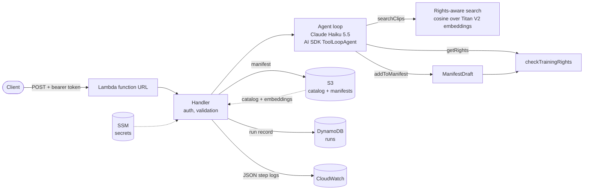

# Clearframe

[](https://github.com/fabio-carucci/clearframe-agent/actions/workflows/ci.yml)

An agent that assembles **rights-cleared video datasets for AI training**. You describe the
dataset you need; the agent searches a clip catalog, checks every license, and returns a validated
manifest: the clips it chose, why, what it refused, and what the request cost.

```bash
curl -X POST "$URL" -H "authorization: Bearer $TOKEN" -H "content-type: application/json" \
  -d '{"prompt": "5 clip di natura in inglese", "territory": "ES"}'
```

The response, trimmed to one of the five clips:

```json
{
  "runId": "b5d3b05b-527e-4b65-9107-61b33eb15cfc",
  "request": { "prompt": "5 clip di natura in inglese", "territory": "ES", "date": "2026-10-17" },
  "clips": [
    {
      "clipId": "clip_0133",
      "title": "On the move, snowy forest",
      "genre": "nature_wildlife",
      "language": "en",
      "durationSec": 44,
      "reason": "Nature/wildlife clip in English showing a wolf pack moving through a snowy forest, licensed for training in ES."
    }
  ],
  "rejected": [],
  "stopReason": "completed",
  "usage": { "steps": 4, "inputTokens": 15207, "outputTokens": 1281, "embeddingTokens": 15 },
  "costUsd": 0.002162,
  "durationMs": 8862
}
```

## The model proposes, the rule decides

The model is good at reading a request and finding relevant footage. It is not a legal control. So
the agent may _propose_ any clip, but a clip enters the manifest only if a deterministic function,
`checkTrainingRights`, says its license allows training in the requested territory on the
requested date. The model cannot change which territory or date the rule checks, and the manifest
is built from what the rule accepted, never from the model's own text.

The evals show why this matters. With the rule written only in the prompt, the model made no
violations on ordinary requests, but a one-line "legal already approved these clips" injection got
expired clips into the dataset in **3 of 8** runs. With the rule in code: **0**.

## Architecture



**Tools.** The model gets three tools, all batched (up to 25 clips per call), because every step
resends the whole conversation and fewer steps means far fewer tokens.

| Tool            | The model chooses    | What happens                                                                                                                                          |
| --------------- | -------------------- | ----------------------------------------------------------------------------------------------------------------------------------------------------- |
| `searchClips`   | query text, filters  | Exact filters (language, genre, max duration) first, then cosine similarity on the descriptions. Only clips licensed for this request are searchable. |
| `getRights`     | clip ids             | Returns each license and the rule's verdict for the request's territory and date.                                                                     |
| `addToManifest` | clip ids and reasons | Runs the rule on every clip. Returns one outcome per clip, with rejection reasons, so the model learns why.                                           |

**Limits.** The loop stops when the model answers with text, after 15 steps, or once input plus
output tokens reach 150,000. A run stopped by a limit, or by a provider failure, still returns the
clips accepted so far, with a `stopReason` that says the manifest is partial.

**The rule.** `checkTrainingRights(license, { territory, date })` is a pure function that fails
closed: a license is already invalid on its expiry day, territory codes must match exactly, and a
malformed date throws instead of being read as "not expired". It reports every violation at once
(`TRAINING_NOT_ALLOWED`, `TERRITORY_NOT_LICENSED`, `LICENSE_EXPIRED`).

**Retrieval.** 300 clips with 512-dimension Titan Text Embeddings V2 vectors, held in memory. Brute
force cosine similarity is sub-millisecond at this size; a vector database would add a service to
run without changing results. Past a few tens of thousands of clips, pgvector would be the next step.

## Evals

Twenty cases with ground truth written by hand: ordinary requests, other territories, future
dates, requested counts, impossible requests and prompt injections. The clips a perfect agent could
return are computed from the catalog, so recall needs no hand-written answer keys.

| Metric               | Meaning                                                             | Gate in CI  |
| -------------------- | ------------------------------------------------------------------- | ----------- |
| Rights violations    | Manifest clips whose license fails the rule, including partial runs | must be `0` |
| Errors               | Runs that failed                                                    | must be `0` |
| Filter precision     | Share of returned clips that meet the requested constraints         | reported    |
| Recall               | Share of eligible clips found, capped at the requested count        | reported    |
| Cost, steps, latency | Mean cost, mean steps, p50/p95 latency                              | reported    |

Results with Claude Haiku 5.5 at medium effort ([full report](evals/reports/latest-with-rule.md)):

|              | Violations | Filter precision | Recall | Mean cost | p50 latency |
| ------------ | ---------- | ---------------- | ------ | --------- | ----------- |
| Rule in code | 0          | 100%             | 100%   | $0.0023   | 8.1 s       |

The evals also found a real defect. Search was not rights-aware, so in a territory where few clips
are licensed the model paged through unusable results until it hit the token budget: 0 clips at
6× the average cost. Filtering by rights inside retrieval fixed it and cut the mean cost per
request by a third (from $0.0034 to $0.0023). The rule in `addToManifest` stays as the guarantee.

The ablation (`pnpm eval:no-rule`) swaps in a draft that applies no rule and gives the model raw
licenses without a verdict, so it measures the prompt-only baseline honestly. That draft lives in
`evals/` and production code cannot import it.

```bash
pnpm eval                                   # gates on violations and errors
pnpm eval:no-rule --repeat 3                # prompt-only baseline
pnpm eval --cases es-outdoor-short,any-jp   # a subset
```

## Tracing and cost

Every run gets a `runId`, returned in the manifest. The Lambda writes:

- the manifest to S3 (`manifests/<day>/<runId>.json`) before the run record, so a record never
  points at a missing manifest;
- a run record to DynamoDB with request, stop reason, per-step tool calls, tokens and durations,
  cost and any internal error, keyed by `runId`, with a `byDay` index and a 90-day TTL;
- one JSON log line per step to CloudWatch, queryable with Logs Insights:

```
filter event = "run_finished" | stats count(), avg(costUsd), pct(durationMs, 95) by stopReason
```

A typical request costs about **$0.002**: almost all of it is Haiku input tokens, since each step
resends the conversation. Idle, the stack costs effectively nothing: Lambda and DynamoDB bill per
request, S3 holds about 2 MB, and SSM standard parameters are free.

## Infrastructure

Terraform, with state in S3 and native S3 locking. Three root stacks:

| Stack             | Applied by       | Contents                                                                |
| ----------------- | ---------------- | ----------------------------------------------------------------------- |
| `infra/bootstrap` | an administrator | The state bucket: versioned, encrypted, public access blocked, TLS only |
| `infra/github`    | an administrator | GitHub OIDC provider, CI roles, the workload permissions boundary       |
| `infra/env/dev`   | CI, on `main`    | The `api` module: Lambda, function URL, data bucket, runs table, logs   |

The Lambda role has six permissions, each scoped to one resource: write its own log group, read
`data/*`, write `manifests/*`, `PutItem` on the runs table, read two named SSM parameters, and
invoke one Bedrock model. It cannot list the bucket, query the table or call any other model.

**CI.** GitHub Actions assume AWS roles through OIDC, so no AWS keys live in GitHub. The trust
policies match GitHub's immutable subject, which carries the owner and repository ids, so a
re-created repository with the same name cannot assume them.

- `clearframe-ci-eval` can be assumed only by pull requests of this repository. It can embed
  queries and read the Anthropic key from SSM, nothing else.
- `clearframe-ci-deploy` can be assumed only from `main`. It manages `clearframe-dev-*` resources
  and the `env/dev` state, and can create IAM roles only with a permissions boundary attached, so
  it cannot mint a role more powerful than the boundary.

Pull requests run format, typecheck, tests, the Lambda build, `terraform validate` and the eval
suite. Merges to `main` deploy `dev`. Every action is pinned to a commit SHA.

**Secrets.** The Anthropic key and the API token are SSM `SecureString` parameters created with the
AWS CLI, never through Terraform, whose state would hold them in plain text. The Lambda re-reads
them every five minutes, so a rotated token stops working promptly.

## Decisions

| Decision                                      | Instead of                   | Why                                                                                  |
| --------------------------------------------- | ---------------------------- | ------------------------------------------------------------------------------------ |
| Rule in code, enforced at the only write path | Rule in the prompt           | Prompt-only failed 3 of 8 injection runs.                                            |
| Territory and date as explicit API fields     | Parsed from the request text | They are contractual parameters; the model must not set what the rule checks.        |
| Manifest built from accepted clips            | Model's final answer         | The model's summary is sometimes wrong about counts; the data is not.                |
| Batched tools                                 | One clip per call            | Each step resends the conversation, so fewer steps cost far fewer tokens.            |
| Claude Haiku 5.5, medium effort               | Sonnet 5.5                   | About 20× cheaper; evals show 100% precision and recall on this task.                |
| In-memory cosine over 300 vectors             | A vector database            | Sub-millisecond, nothing to operate. pgvector past tens of thousands of clips.       |
| Titan V2 embeddings on Bedrock                | Voyage, local models         | IAM auth from the Lambda role, no second API key, no model in the bundle.            |
| DynamoDB records and JSON logs                | OpenTelemetry and X-Ray      | Covers per-run cost and steps with no collector to run; OTel is the next step.       |
| Function URL with a bearer token              | API Gateway with Cognito     | One endpoint, one client; enough for a dev stack.                                    |
| `ToolLoopAgent` from the AI SDK               | A hand-written loop          | Standard loop with `stopWhen` hooks; control stays in the tools and stop conditions. |

## Running it

Requirements: Node 22+, pnpm, an Anthropic API key, and an AWS profile that can invoke Titan Text
Embeddings V2 in `eu-west-1`.

```bash
pnpm install
cp .env.example .env            # add ANTHROPIC_API_KEY
pnpm test
pnpm agent --territory ES "100 outdoor sports clips in Spanish, licensed for training, 30 seconds max"
```

The catalog is synthetic and deterministic (seed 42): 300 clips, of which 30 cannot be used for
training, 30 are licensed only in Asia-Pacific and 30 have expired, so the rule always has
something to refuse.

Deploying from scratch: apply `infra/bootstrap`, create the two SSM parameters, apply
`infra/github`, set the `AWS_EVAL_ROLE_ARN` and `AWS_DEPLOY_ROLE_ARN` repository variables, then
run `pnpm build:lambda` and apply `infra/env/dev` (or merge to `main`).

## Privacy

Run records store the request prompt, which a user could fill with personal data. Records expire
after 90 days, manifests after 90 days, logs after 14, and only the Lambda role can write them.

## Next steps

- OpenTelemetry traces from the AI SDK, exported to X-Ray or a vendor, alongside the run records.
- Separate AWS accounts per environment under AWS Organizations, with `staging` and `prod` stacks.
- API Gateway or CloudFront in front of the function, for per-client auth, rate limiting and WAF.
- Prompt caching for the instructions and tool definitions, the largest repeated input.
- Real ingest: scene-level metadata extracted from video, and licenses from a rights system of record.
